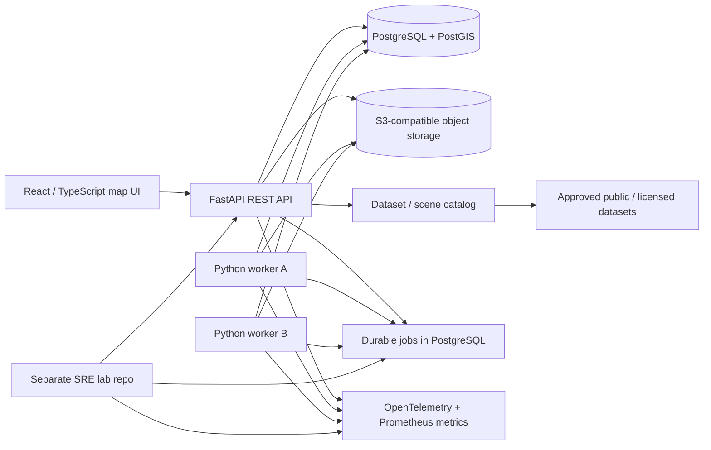

# Nigerian Critical Minerals Platform — Engineering System Overview

**Document type:** Shared engineering specification  
**Placement:** Copy this file to `docs/ENGINEERING_OVERVIEW.md` in both repositories.  
**Audience:** Engineers, coding agents, architecture/planning agents, reviewers.  
**Scope:** Technical implementation only. This document intentionally excludes business strategy and schedules.

## 1. Mission and boundaries

Build a reproducible geospatial analysis application focused initially on a **small area of interest (AOI) near Keffi, Nasarawa State, Nigeria**. Users can inspect contextual geological layers, run satellite-derived exploratory indicators, compare land cover or disturbance across dates, and obtain auditable outputs. A second repository deploys this exact application and evaluates its operational reliability under load and failure.

The two repositories are separate deliverables but one technical system:

- **`nigeria-critical-minerals` (Project 1):** application, APIs, geospatial processing, durable distributed job execution, persisted results, user interface, application instrumentation.
- **`geospatial-sre-lab` (Project 2):** deployment/test harness, observability dashboards and alerts, load generation, fault injection, reliability experiments, incident artifacts and operational runbooks.

Project 2 must **consume a pinned version** of Project 1, not fork or duplicate its source. Project 1 must function without Project 2.

### Non-goals

- No claim to discover or quantify subsurface lithium deposits from satellite imagery.
- No mineral reserve/resource estimation, investment recommendations, or autonomous fieldwork planning.
- No unverified private data ingestion, proprietary dataset redistribution, or mining-title assertions.
- No requirement for Kubernetes, machine learning, or nationwide coverage in the initial technical baseline.
- No custom general-purpose orchestration framework beyond the functionality required to make this system correct.

## 2. User workflows and scientific interpretation

1. **Explore:** select an AOI and inspect available geological context, imagery footprints, provenance, and known occurrence records when licensed and verifiable.
2. **Analyze spectral indicators:** request processing of a bounded AOI and imagery date range; return selected surface spectral features, masks, confidence/quality metadata, and a reproducible map layer.
3. **Compare dates:** select two acquisition windows; generate co-registered, cloud-masked imagery comparisons and a **surface-change candidate** layer. Do not automatically label every change as mining.
4. **Inspect results:** review layer legend, algorithm version, input scenes, processing parameters, uncertainty and limitations, job history, and download a machine-readable manifest plus optional report.
5. **Recover:** retry failed transient work, resume after worker death, avoid publishing duplicate or partial results.

**Scientific guardrail:** spectral responses are indirect surface observations affected by weathering, vegetation, soils, cloud/shadow, resolution and sensor characteristics. A lithium-bearing pegmatite is not equivalent to a remotely detected lithium concentration. Ground-truth verification requires qualified geologists and field/laboratory evidence.

## 3. Reference architecture

### Stack decisions

| Layer | Preferred choice | Notes |
|---|---|---|
| Language | Python 3.12+ | Core API, worker, algorithms and interviews; pin exact version in repo |
| API | FastAPI + Pydantic v2 | OpenAPI, request validation, typed contracts |
| UI | React + TypeScript + Vite | MapLibre GL JS or Leaflet; choose one and document rationale |
| Database | PostgreSQL + PostGIS | Job coordination, AOIs, spatial metadata, audit records |
| DB access | SQLAlchemy 2 + Alembic | Explicit transaction boundaries; raw SQL where concurrency requires it |
| Workers | Python processes | PostgreSQL-backed durable queue, no hidden in-memory source of truth |
| Raster/geospatial | Rasterio, GDAL, GeoPandas, Shapely, PyProj, NumPy | Pin GDAL-compatible versions; validate CRS and nodata behavior |
| Imagery catalog | STAC-compatible metadata via pystac-client where available | Dataset discovery and immutable scene IDs |
| Objects | S3-compatible storage; MinIO locally | Raster outputs, thumbnails, manifests, reports |
| Raster serving | COG files + optional TiTiler | Avoid serving large rasters through the API process |
| Containerization | Docker Compose | Reproducible local and test deployments |
| Tests | pytest, pytest-asyncio where needed, Testcontainers or Compose | Real PostgreSQL required for lease/concurrency tests |
| Telemetry | OpenTelemetry, Prometheus metrics, structured JSON logs | Instrumentation code in Project 1; collector/dashboards in Project 2 |
| Load/fault tests | Locust or k6; shell/Python failure harness | Owned by Project 2 |

Do not add Redis, Kafka, Kubernetes, Celery, or an ML stack without a demonstrated requirement. A database queue is deliberate because its transaction semantics are central to the engineering exercise.

## 4. Contracts between repositories

Project 1 exposes stable, versioned contracts consumed by Project 2:

- **REST API:** `/api/v1/health/live`, `/api/v1/health/ready`, `/api/v1/datasets`, `/api/v1/aois`, `/api/v1/jobs`, `/api/v1/jobs/{id}`, `/api/v1/jobs/{id}/artifacts`, `/api/v1/analyses/...`.
- **Telemetry:** `/metrics` with documented counters/histograms/gauges; OpenTelemetry trace propagation and structured logs containing `request_id`, `job_id`, `attempt_id`, `worker_id`, and `trace_id` when available.
- **Job states:** `queued`, `leased`, `running`, `succeeded`, `failed`, `cancelled`; terminal states immutable absent explicit administrative action.
- **Artifact manifest:** schema-versioned JSON containing AOI, CRS, source scene IDs, processing parameters, software/algorithm versions, masks, checksums, output paths, and warnings.
- **Container images:** immutable tags/digests for API, worker, UI; Project 2 pins digests or release tags.
- **Test fixtures:** tiny, redistributable AOI/raster fixtures with expected deterministic outputs, plus synthetic stress workloads that do not depend on external network availability.

### Suggested minimal data model

- `dataset`: id, license, source_url, citation, retrieval timestamp, version, spatial extent, CRS, redistribution flag.
- `scene`: id, dataset_id, acquisition time, cloud metadata, asset references, checksum, footprint.
- `aoi`: id, geometry (PostGIS), label, CRS metadata, area, creator/context.
- `job`: id, type, input_hash, parameters JSONB, state, priority, created/updated timestamps, attempt_count, max_attempts, lease_owner, lease_expires_at, next_attempt_at, last_error.
- `job_attempt`: id, job_id, worker_id, start/end, status, heartbeat timestamps, error category.
- `artifact`: id, job_id, kind, object key, checksum, media type, manifest version, created timestamp.
- `analysis_run`: id, job_id, algorithm name/version, scene IDs, AOI ID, quality summary.

## 5. Cross-cutting correctness requirements

**Durable execution:** claim jobs atomically using a row-locking transaction (e.g. `FOR UPDATE SKIP LOCKED`), a unique lease token, and a lease expiry. Heartbeat renewals must verify ownership. Expired leases can be reclaimed. Distinguish retryable errors from permanent invalid inputs; use bounded exponential backoff and a dead-letter/failed terminal outcome. Use idempotent artifact naming and atomic publication (write temporary object, validate checksum, publish manifest, then mark job succeeded). Assume **at-least-once execution**, not exactly-once processing.

**Geospatial correctness:** accept and store AOI geometry in a documented CRS; transform explicitly; validate polygon topology, area limits, antimeridian assumptions, bounds, raster alignment, pixel size, nodata, cloud/shadow masking, acquisition window, and output coordinate systems. Never compare unaligned rasters pixel-by-pixel. Maintain deterministic fixtures for coordinate transformations and spectral indices.

**Data provenance:** only ingest datasets with documented licensing and usage permissions. Record the original provider and acquisition metadata. Separate public demo fixtures from restricted data. No secrets, credentials, private geospatial datasets, or personal location records in Git history. Distinguish scientific uncertainty from pipeline failures.

**Security and cost:** restrict AOI area and resolution, cap job concurrency and object size, validate URLs to prevent SSRF, enforce timeouts and memory limits, and avoid executing arbitrary user-provided code. Apply authentication and per-user quotas before exposing a public multi-tenant service.

**Observability:** expose queue depth, oldest queued age, active leases, attempts, retries, failures, processing duration, artifact publishing failures, API latency and errors, and worker resource use. Avoid high-cardinality labels such as job IDs in Prometheus; put them in logs/traces.

## 6. Acceptance criteria for the integrated system

- A small Keffi AOI can be created, displayed and queried through API and UI.
- A documented dataset/imagery fixture can be loaded with explicit provenance and valid CRS.
- A user can submit an analysis and observe durable state transitions through completion.
- A known synthetic raster produces a verifiably correct output within a documented numeric tolerance.
- A cloud-masked, co-registered two-date fixture produces an expected change layer.
- Killing a worker mid-job results in safe reclaim/retry and one committed artifact manifest.
- A duplicate client submission using an idempotency key does not create duplicate logical work.
- Project 2 can launch a pinned Project 1 build, execute deterministic load/failure tests, and export a report with traceable configuration and evidence.
- Both repos document setup, environment variables, test commands, architecture decisions and known limitations.

## 7. Documentation and agent operating contract

All coding and planning agents should:

1. Read this overview, then the repository-specific `PROJECT_SPEC.md`, then `README.md`, ADRs, and existing tests before changing architecture.
2. Identify affected APIs, schema migrations, job state transitions, security boundaries and observability before implementing changes.
3. Prefer small, testable increments. Add a failing test for bugs before fixing them.
4. Do not invent geological claims, field validation, private datasets, data licenses, measured benchmarks, or operational results.
5. Never claim a test passed unless it actually ran. Record commands, fixtures, environment, and output.
6. Keep scientific assumptions and processing algorithms versioned; distinguish demonstration data from field-validated evidence.
7. Keep Project 2 dependent on Project 1's published interfaces, not its internal database tables unless explicitly documented for a test-only environment.
8. For major design changes, write an ADR explaining alternatives, tradeoffs and migration implications.

### Recommended repository layout

**Project 1:** `apps/api/`, `apps/web/`, `workers/`, `packages/geospatial/`, `db/migrations/`, `infra/local/`, `tests/`, `fixtures/`, `docs/adr/`, `docs/ENGINEERING_OVERVIEW.md`, `docs/PROJECT_SPEC.md`.

**Project 2:** `deploy/`, `observability/`, `load-tests/`, `faults/`, `scenarios/`, `reports/`, `runbooks/`, `docs/adr/`, `docs/ENGINEERING_OVERVIEW.md`, `docs/PROJECT_SPEC.md`.

## 8. Open questions to resolve in ADRs

- Which verified, redistributable geological layers are available for the Keffi demonstration?
- Which imagery source, temporal windows, and quality thresholds will the first reproducible analyses use?
- Which map library and raster tile-serving approach best fits the deployment constraints?
- Which spectral indicators are scientifically appropriate for the available sensor and geology?
- Which numerical and spatial validation thresholds are defensible for each algorithm?
- Which deployment profile (single host vs multiple hosts) is required for a given reliability experiment?

Until answered, treat these as explicit unknowns, not implicit facts.
