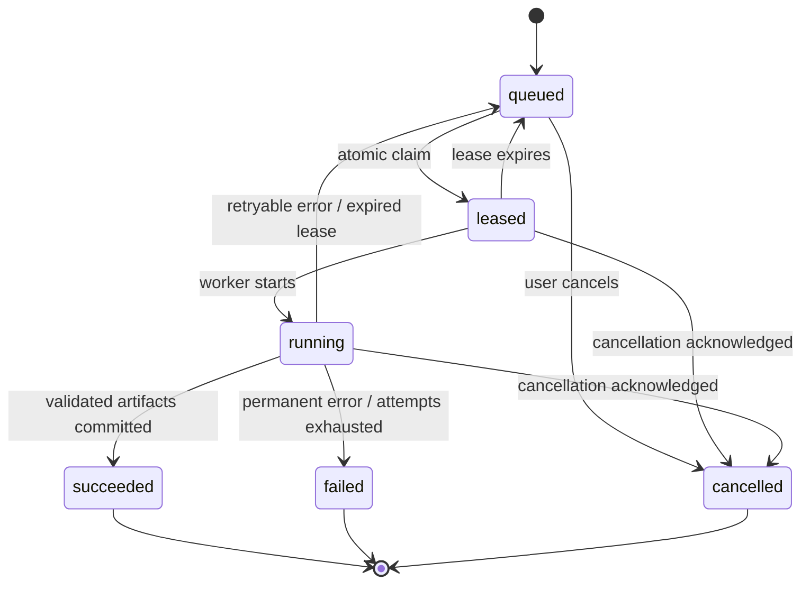

# Project 1 — Nigerian Critical Minerals Intelligence Platform

**Repository:** `nigeria-critical-minerals`  
**Suggested path:** `docs/PROJECT_SPEC.md`  
**Audience:** Software engineers, geospatial engineers, coding agents, planning agents.  
**Read first:** `docs/ENGINEERING_OVERVIEW.md`.

## 1. Product and technical goal

Implement an auditable web application for **exploratory critical-mineral geospatial intelligence**, initially scoped to a bounded study area near **Keffi, Nasarawa State, Nigeria**. The application integrates:

- **B — Geological explorer:** discover and visualize approved geological context layers and documented occurrences.
- **A — Satellite indicator analysis:** compute defensible, sensor-appropriate surface indicators for exploration screening; explicitly avoid claims of direct lithium detection.
- **C — Land-surface change analysis:** compare quality-controlled, co-registered imagery from two periods to identify candidate disturbance/change, not automatically mining activity.

The engineering centerpiece is a **Python/PostgreSQL distributed job scheduler** supporting CPU- and I/O-intensive geospatial tasks with durable state, worker leases, retry policies, and auditable artifacts.

### Primary user stories

- As an analyst, I can draw or upload a small valid AOI and inspect its bounds, area and CRS.
- As an analyst, I can toggle geological and satellite layers and inspect provenance and legends.
- As an analyst, I can submit an analysis with explicit parameters and view job progress, errors and final artifacts.
- As an analyst, I can compare two imagery windows and see candidate surface changes and quality masks.
- As a reviewer, I can reproduce a run from its manifest, scene IDs, algorithm version and parameter set.
- As an operator, I can restart workers without silently losing or double-publishing results.

## 2. Proposed module boundaries

```text
nigeria-critical-minerals/
├── apps/
│   ├── api/                 # FastAPI routes, DTOs, service layer, auth placeholder
│   └── web/                 # React/TS map, job views, dataset metadata
├── workers/
│   ├── runner/              # claim, lease, heartbeat, execute, finalize
│   └── tasks/               # named task handlers, no HTTP coupling
├── packages/
│   ├── scheduler/           # job state machine, persistence, retry logic
│   ├── geospatial/          # CRS, raster transforms, masking, indicators
│   ├── catalog/             # dataset/scene adapters and provenance
│   └── contracts/           # manifest schemas, event types, API models
├── db/migrations/          # Alembic
├── infra/local/            # Compose, local object storage, database
├── fixtures/               # tiny synthetic rasters and AOIs; licenses
├── tests/                  # unit, integration, e2e, scientific regression
└── docs/                   # overview, spec, ADRs, dataset cards, runbooks
```

Dependencies flow **UI → API → services → database/storage** and **worker runner → task handlers → geospatial/catalog**. Task handlers must not import FastAPI route modules. Scientific transforms should be pure functions where feasible.

## 3. Data and geospatial design

### AOI handling

- Accept GeoJSON Polygon/MultiPolygon (initially one bounded AOI per request).
- Normalize incoming coordinates as WGS84 (`EPSG:4326`) for interchange; use an appropriate projected CRS for area/distance and raster operations.
- Validate geometry, orientation where relevant, self-intersections, coordinate bounds, maximum AOI area, vertex count and feature count.
- Store original request and normalized geometry; make transforms explicit in manifests.
- Do not infer a precise mineral occurrence from a broad regional map or imprecise geocoding.

### Dataset registry

Every dataset must have a dataset card with: provider, source URL, title, retrieval date, version, CRS, spatial/temporal coverage, resolution/scale, attribution, license and redistribution rights, known limitations, and integrity checksum when feasible. If rights are unclear, do not bundle it in public fixtures.

Potential categories: geological polygons, faults/lineaments, documented occurrence points, administrative boundaries, Sentinel-2 optical scenes, elevation models, and later field samples. **Availability and permissions must be checked; no dataset is assumed accessible merely because a portal advertises it.**

### Raster processing baseline

1. Resolve immutable source scene identifiers and asset metadata.
2. Fetch or use cached assets; validate checksum/metadata.
3. Apply cloud, cloud-shadow and invalid-pixel masks using sensor-appropriate quality layers.
4. Reproject and align to a declared grid; record target CRS, transform, extent, pixel size and resampling method.
5. Compute simple, explainable spectral indicators and summary statistics; store masks separately.
6. Export a Cloud Optimized GeoTIFF (COG), small preview, JSON manifest and numeric quality summary.
7. Validate artifacts before publication.

**Do not interpret spectral indices as proof of lithium, tantalum or niobium.** Prefer labels such as `spectral_indicator`, `surface_material_proxy` or `exploratory_anomaly`. Document what the indicator measures, sensor limitations, confounders, and any peer-reviewed or authoritative methodological support before making geological inferences.

### Change detection baseline

- Select two acquisition windows with explicit date, season and cloud-coverage metadata.
- Use comparable sensor products and consistent atmospheric preprocessing where possible.
- Align rasters on a shared grid and ensure nodata/cloud/shadow masks propagate correctly.
- Produce a deterministic difference metric and thresholded **candidate-change** mask with sensitivity parameters recorded.
- Report area of valid overlap, masked fraction, threshold, connected-region statistics and uncertainty/limitations.
- Avoid interpreting seasonal vegetation change, agriculture, construction, erosion or water fluctuation as mining without external evidence.

## 4. Scheduler design

### State machine



Actual state transitions must be guarded in SQL; a state diagram alone is not concurrency control. Consider simplifying `leased` and `running` if the distinction creates unneeded complexity, but preserve ownership and attempt semantics.

### Atomic claim and lease fencing

- In one short DB transaction, select an eligible queued job with `FOR UPDATE SKIP LOCKED`, increment attempt count, set worker ID, lease token and expiration, and persist the attempt record.
- Heartbeats and completion updates require matching `(job_id, lease_token)` and valid state. An expired worker must never overwrite a newer attempt's result.
- Reclaimer makes expired work eligible again, with a bounded retry policy.
- Separate transient failures (network/temporary storage) from permanent failures (invalid geometry, missing rights, malformed raster).
- Never hold a database transaction open during long raster processing.
- Job payloads reference immutable input IDs and parameter hashes; avoid embedding large arrays in JSONB.

### Idempotency and publication

- Client accepts `Idempotency-Key` (scoped appropriately) and returns the existing logical job for repeated submissions.
- Task output paths include job ID, attempt ID and/or content hashes; attempts write to isolated temporary keys.
- Finalization verifies output checksums and ownership, writes a versioned manifest, commits artifact metadata and success state transactionally as far as the DB allows.
- Object storage and PostgreSQL do not share a transaction: design for orphan cleanup and safe replays, not impossible cross-system atomicity.
- Use a single winning attempt; older attempts cannot publish a new canonical manifest.

### Scheduling and resource controls

- Queue categories may distinguish `metadata`, `raster`, and `report` workloads.
- Define per-task CPU, memory, runtime and AOI-size budgets; bound concurrent heavy raster jobs.
- Track queue wait time, attempt count and worker saturation.
- Prevent starvation by documenting priority and fairness policy.
- Add cancellation checkpoints at safe boundaries; do not assume a Python thread can be forcibly stopped safely.

## 5. API design (proposed)

| Method | Route | Purpose |
|---|---|---|
| GET | `/api/v1/health/live` | Process liveness; no downstream dependency |
| GET | `/api/v1/health/ready` | API readiness, essential dependencies |
| GET | `/api/v1/datasets` | Dataset cards and allowed layers |
| POST | `/api/v1/aois` | Validate and persist AOI |
| GET | `/api/v1/aois/{id}` | AOI details and geometry |
| POST | `/api/v1/analyses/spectral` | Submit spectral job |
| POST | `/api/v1/analyses/change` | Submit two-date comparison |
| GET | `/api/v1/jobs/{id}` | State, progress, errors, timestamps |
| POST | `/api/v1/jobs/{id}/cancel` | Request cancellation |
| GET | `/api/v1/jobs/{id}/artifacts` | Manifest and authorized artifact URLs |
| GET | `/metrics` | Prometheus scrape endpoint, protected as needed |

Use OpenAPI-generated TypeScript types or equivalent contract tests to prevent UI/API drift. Validate enums and parameter ranges. Return stable machine-readable error codes. Avoid leaking object-store credentials or internal filesystem paths.

Example job request:

```json
{
  "aoi_id": "aoi-example",
  "dataset_id": "approved-imagery-collection",
  "scene_ids": ["scene-a"],
  "algorithm": "documented_indicator_v1",
  "parameters": {"cloud_mask": true, "target_resolution_m": 20}
}
```

Example artifact manifest shape:

```json
{
  "schema_version": "1.0",
  "job_id": "job-example",
  "algorithm": {"name": "documented_indicator", "version": "1.0"},
  "inputs": {"aoi_id": "aoi-example", "scene_ids": ["scene-a"]},
  "grid": {"crs": "EPSG:32632", "resolution_m": 20},
  "quality": {"valid_pixel_fraction": 0.82},
  "artifacts": [{"kind": "cog", "object_key": "results/example.tif", "sha256": "..."}],
  "warnings": ["Exploratory surface indicator; not mineral confirmation"]
}
```

The example CRS is illustrative, not a default for all Keffi AOIs; select and validate actual projection per region.

## 6. UI behavior

- Map with basemap, AOI drawing/upload, legend, layer toggles, opacity, scale, coordinate display and source attribution.
- Dataset panel with provenance, license/quality flags and resolution/scale warnings.
- Analysis form that exposes required parameters and prevents oversized or invalid submissions.
- Jobs panel with queued/running/failed/succeeded status, attempts, timestamps, errors and links to artifacts.
- Results panel with source-scene list, before/after view for change analysis, masks, numeric summaries and limitations.
- Clear distinction between **observed raster change**, **exploratory spectral indicators**, and **validated geological observations**.
- Graceful empty, unavailable-dataset, long-running and failed-job states.

## 7. Testing and verification

### Unit tests

- Known small arrays for spectral formulas, nodata and mask propagation, zero denominators, thresholding and connected-component calculations.
- AOI validity, CRS round-trips, projected area, antimeridian/invalid-coordinate rejection where applicable.
- State transition guards, retry classification, idempotency key handling and parameter validation.

### Integration tests (real PostgreSQL/PostGIS)

- Two workers race for the same job: one lease winner.
- Worker dies mid-task: lease expires and a second worker completes.
- Stale worker tries to heartbeat/finalize: rejected by fencing token.
- Retryable failure vs permanent failure: correct backoff and terminal outcome.
- Duplicate submission: one logical job.
- Artifact write succeeds but DB commit fails: no false success; replay/cleanup is safe.
- Object-store artifact unavailable or corrupted: validation fails visibly.

### Scientific/geospatial regression

- Synthetic aligned rasters with exact expected differences and area calculations.
- Misaligned rasters: explicit resampling/reprojection or validation error.
- Entirely masked scene: clear no-valid-data outcome, not fabricated zero change.
- Same scene compared with itself: near-zero change within numeric tolerance.
- Fixture with known changed patch: expected detection and false-positive/false-negative counts.
- Metadata tests for provenance and licensing fields.

### End-to-end

Start local Compose; upload AOI; submit one synthetic analysis; watch job status; view COG overlay; download manifest; restart worker during another run; confirm correct final state. No external imagery network dependency for the CI smoke path.

## 8. Application observability and security

**Metrics:** `http_request_duration_seconds`, `http_requests_total`, `jobs_submitted_total`, `jobs_completed_total`, `job_attempts_total`, `job_duration_seconds`, `job_queue_wait_seconds`, `job_queue_depth`, `job_lease_expirations_total`, `artifact_publish_failures_total`; labels should be low-cardinality.

**Logs/traces:** correlation IDs, explicit error categories, redacted parameters, source scene IDs where safe, worker/attempt identity, trace spans for catalog lookup, claim, download, mask, transform, compute, upload, finalize.

**Security:** environment-based credentials, least-privilege DB/object permissions, URL allowlists, bounded file size and raster dimensions, no user-supplied Python execution, safe temporary-file cleanup, CORS configuration, rate limiting/auth if internet exposed.

## 9. Definition of done

- A reproducible local setup and documented sample dataset run without private credentials.
- Both analysis workflows complete with valid, inspectable outputs and versioned manifests.
- Results can be checked against deterministic synthetic fixtures and source metadata.
- Worker lease, retry, crash recovery, fencing and idempotency are covered by real DB tests.
- Application exposes stable API, health checks, metrics and trace context for Project 2.
- README explains claims the software **does and does not** make about critical minerals.

## 10. Agent task template

For each proposed implementation task, provide:

1. **Goal and user-visible behavior**
2. **Touched modules/contracts**
3. **Schema or API changes**
4. **Failure modes and scientific assumptions**
5. **Tests/fixtures to add**
6. **Telemetry and operational effects**
7. **Verification commands and actual results**
8. **Open questions/ADR needed**

Never silently replace scientifically meaningful algorithms with invented formulas or synthetic 'ground truth' represented as real observations.
