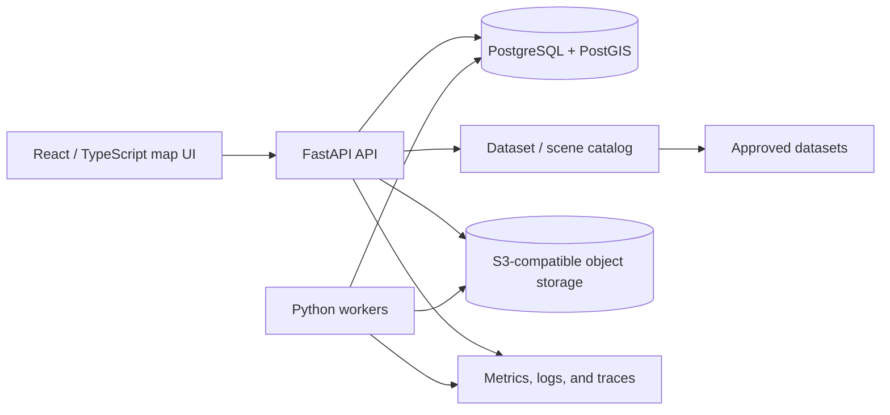

# Nigerian Critical Minerals Intelligence Platform

A planned geospatial intelligence application for exploratory analysis near **Keffi, Nasarawa State, Nigeria**, built around a durable **Python/PostgreSQL distributed job scheduler**.

The platform is designed to combine geological context, satellite-derived surface indicators, and land-surface change analysis with reproducible inputs and auditable results.

## Project status

**Specification stage.** This repository currently contains the engineering overview and application specification. API, UI, workers, database migrations, infrastructure, and tests have not yet been added. Features and technology choices below describe the intended implementation.

There is no runnable application or installation procedure yet. Setup commands, environment variables, dependency versions, and test commands should be documented here as their corresponding implementation is introduced.

## Documentation

Read these documents in order:

1. [Engineering system overview](ENGINEERING_OVERVIEW.md) — mission, architecture, preferred stack, cross-repository contracts, and correctness requirements.
2. [Project specification](PROJECT_1_SPEC.md) — application workflows, scheduler design, proposed APIs, testing strategy, and definition of done.

The documents suggest eventual locations under `docs/`; the links above point to their current locations at the repository root.

## Planned workflows

- **Explore geological context:** draw or upload a bounded area of interest (AOI), inspect its geometry and area, and view approved geological layers with provenance and licensing information.
- **Analyze satellite indicators:** submit sensor-appropriate surface analysis and inspect quality masks, numeric summaries, and reproducible map layers.
- **Compare dates:** align and mask imagery from two acquisition windows to identify candidate surface changes, with thresholds and uncertainty recorded.
- **Inspect results:** track jobs and attempts, review errors, and download validated artifacts with versioned manifests.
- **Recover interrupted work:** reclaim expired worker leases, retry transient failures, and prevent stale attempts from publishing canonical results.

## Scientific scope

Satellite indicators are indirect surface observations affected by vegetation, soils, weathering, clouds, shadows, spatial resolution, and sensor characteristics. They do **not** establish subsurface lithium deposits, mineral concentrations, or reserves.

Detected surface change is a candidate observation; it is not automatically evidence of mining. Geological interpretation requires qualified review and field or laboratory evidence. The initial scope excludes reserve estimation, investment recommendations, autonomous fieldwork planning, and unverified mining-title claims.

## Planned architecture



PostgreSQL is the durable source of job state and coordination. Object storage holds raster outputs, previews, and manifests. Long-running raster processing runs in worker processes outside API requests and database transactions.

The preferred stack is Python 3.12+, FastAPI with Pydantic v2, SQLAlchemy 2 and Alembic, PostgreSQL/PostGIS, and React/TypeScript with Vite. Geospatial processing is expected to use Rasterio/GDAL, GeoPandas, Shapely, PyProj, and NumPy, with STAC-compatible scene discovery where available. Docker Compose and MinIO are planned for local infrastructure; OpenTelemetry, Prometheus metrics, and structured JSON logs provide instrumentation.

Exact versions, the map library, and the raster tile-serving approach remain to be selected and documented. See the [engineering overview](ENGINEERING_OVERVIEW.md) for the full stack rationale and open questions.

## Scheduler design

The scheduler is intended to provide **at-least-once execution** with one winning attempt authorized to publish the canonical result.

- **Atomic claims:** use short PostgreSQL transactions with `FOR UPDATE SKIP LOCKED` to claim eligible jobs and persist attempt ownership.
- **Leases and fencing:** require a matching job ID and lease token for heartbeats and completion; reject stale workers after ownership changes.
- **Recovery and retries:** reclaim expired leases, classify transient and permanent failures, and apply bounded exponential backoff.
- **Idempotency:** repeated submissions with a scoped `Idempotency-Key` return the existing logical job.
- **Safe publication:** isolate attempt outputs, validate checksums and ownership, and commit artifact metadata and success state with guarded database updates.
- **Resource limits and cancellation:** bound heavy workloads and check cancellation at safe processing boundaries.

Planned job states are `queued`, `leased`, `running`, `succeeded`, `failed`, and `cancelled`. PostgreSQL and object storage do not share a transaction, so publication must support safe replay and orphan cleanup.

## Geospatial inputs and outputs

AOIs will accept GeoJSON Polygon/MultiPolygon geometry, normalized to WGS84 (`EPSG:4326`) for interchange. Area calculations and raster operations must use an appropriate, explicitly recorded projected CRS. Geometry, coordinate bounds, area, and complexity limits must be validated before processing.

Every approved dataset needs a dataset card covering its provider, source, version, retrieval date, coverage, CRS, resolution or scale, attribution, license, redistribution rights, and limitations. Dataset availability and permissions are unresolved until verified.

Planned analysis outputs include:

- Cloud Optimized GeoTIFFs (COGs), previews, and separate quality masks.
- Numeric quality summaries and, for change analysis, valid-overlap and candidate-region statistics.
- Versioned JSON manifests recording input scene IDs, AOI, processing grid, parameters, algorithm/software versions, checksums, and interpretation warnings.

## Proposed API

The initial API is planned under `/api/v1`:

- `GET /api/v1/health/live` and `GET /api/v1/health/ready` for liveness and readiness.
- `GET /api/v1/datasets` for approved datasets and metadata.
- `POST /api/v1/aois` and `GET /api/v1/aois/{id}` for AOI validation and retrieval.
- `POST /api/v1/analyses/spectral` and `POST /api/v1/analyses/change` for job submission.
- `GET /api/v1/jobs/{id}` for job state and progress.
- `POST /api/v1/jobs/{id}/cancel` for cancellation requests.
- `GET /api/v1/jobs/{id}/artifacts` for manifests and authorized artifact URLs.
- `GET /metrics` for Prometheus metrics.

These are proposed contracts, not available endpoints. Request and manifest examples are in the [project specification](PROJECT_1_SPEC.md).

## Intended repository layout

The following directories are planned and do not yet exist:

```text
apps/api/              FastAPI routes, models, and services
apps/web/              React map, analysis forms, and job views
workers/runner/        Claims, leases, heartbeats, and finalization
workers/tasks/         Named task handlers
packages/scheduler/    State machine, persistence, and retry policy
packages/geospatial/   CRS, raster alignment, masking, and indicators
packages/catalog/      Dataset and scene adapters
packages/contracts/    Shared schemas and API contracts
db/migrations/         Alembic migrations
infra/local/           Local Compose infrastructure
fixtures/              Small licensed or synthetic AOIs and rasters
tests/                 Unit, integration, geospatial, and end-to-end tests
docs/                  Specifications, ADRs, dataset cards, and runbooks
```

## Verification goals

The implementation must demonstrate deterministic geospatial results and safe distributed execution. Planned coverage includes:

- Unit tests for geometry validation, CRS handling, masks, formulas, state transitions, and parameter validation.
- Integration tests against real PostgreSQL/PostGIS for competing claims, worker death, lease expiry, stale-worker fencing, retries, duplicate submissions, and publication failures.
- Synthetic raster regression tests for alignment, known changed patches, nodata propagation, entirely masked scenes, and same-scene comparisons.
- A local end-to-end run that submits an analysis, displays its output, downloads its manifest, and verifies recovery after a worker restart.

The CI smoke path must run without external imagery downloads or private credentials. No tests or measured results are included yet.

## Relationship to the SRE lab

This repository represents **Project 1**, called `nigeria-critical-minerals` in the specifications. A separate **Project 2**, `geospatial-sre-lab`, is intended to consume a pinned application release for deployment, load testing, fault injection, dashboards, alerts, and reliability experiments.

The application must run independently of the SRE lab. The lab should consume versioned public contracts and immutable builds rather than duplicate application source.

## Implementation guidance

Read both specification documents before making architectural changes. Keep algorithms and assumptions versioned, record dataset rights and provenance, and distinguish synthetic fixtures from field observations. Do not commit credentials, restricted datasets, or personal location records.

Major design decisions should be captured in architecture decision records. Report verification commands and actual results as implementation progresses; do not present planned capabilities or unrun tests as completed work.
